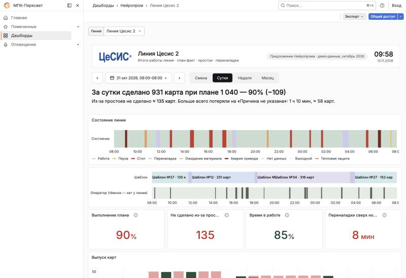
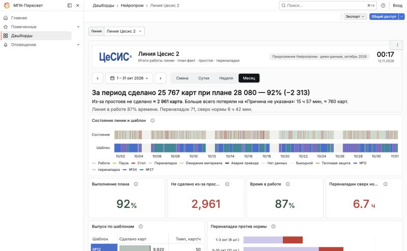
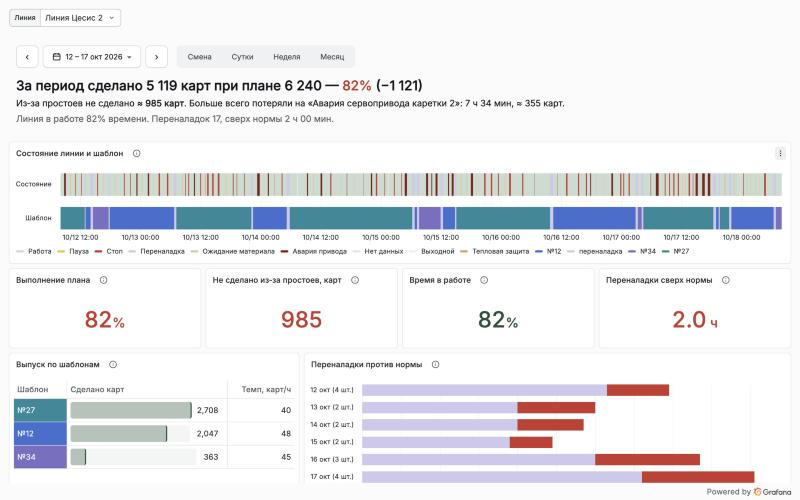
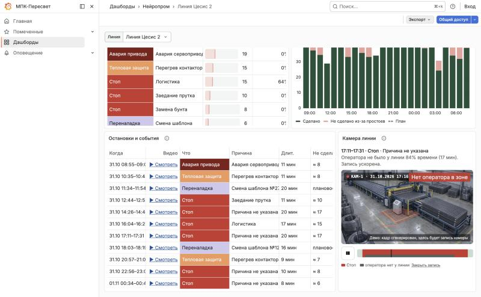

# Линия Цесис 2: дашборд для МПК-Пересвет на Grafana

Это **предложение интерфейса** для начальника производства. Дашборд собран в Grafana 12.4, той же версии, что у Пересвета. Он показывает, как прототип «своей системы» ([kogdanikogda/line-monitoring-prototype](https://github.com/kogdanikogda/line-monitoring-prototype)) может работать внутри платформы. **Все данные вымышлены**: демо за октябрь 2026, две смены по 12 часов, воскресенье выходной.

**Живая версия:** https://77-238-227-42.sslip.io:8443/d/neuroprom-line. Вход не нужен, только просмотр. Первая загрузка занимает 10–20 секунд: сервер демонстрационный и слабый.



| Месяц | Неделя аварий 12–17 окт | Журнал и камера |
| --- | --- | --- |
|  |  |  |

---

## Коротко для специалистов

- **10 панелей из 12 стандартные:** State timeline, Stat, Table, Bar chart, Time series. Их можно править мышкой в редакторе Grafana.
- **2 панели — HTML graphics** (`gapit-htmlgraphics-panel`, у Пересвета он уже стоит). Шапка (поле периода с календарём, итог одной фразой) и окно камеры. Там JavaScript, мышкой не поменять.
- **Все цифры пересчитываются под выбранный период стандартными transformations Grafana.** Работает фильтр по `${__from}` / `${__to}`, Group by, Reduce, Add field from calculation. В панелях нет SQL и кода.
- Чтобы так было и на реальных данных, **источник должен отдавать 5 таблиц** (раздел «Контракт данных» ниже). Расчёт «не сделано карт» и разбивку по дням и неделям лучше делать на стороне Пересвета.

## Что сделано средствами Grafana, а что вручную

| Блок на экране | Как сделан | Править без программиста | Чем заменить, если без кода |
| --- | --- | --- | --- |
| Шапка: логотип, название линии, часы | HTML graphics (HTML + CSS + JS) | Нет | Text panel (часов не будет) |
| Поле периода: одно поле, календарь, применяется сразу; стрелки ‹ ›; пресеты «Смена / Сутки / Неделя / Месяц» | HTML graphics, JS. Меняет период через `htmlGraphics.locationService.partial({from, to})` | Нет | Штатный выбор периода Grafana: два поля и кнопка «Применить» плюс список быстрых периодов Grafana |
| Итог фразой («За сутки сделано 931 карта при плане 1 040 — 90%…») | HTML graphics, JS: суммы, главная причина, склонение «карта / карты / карт» | Нет | Stat-панели без фразы; или Business Text (Handlebars + helpers, тоже код) |
| Автоматический масштаб: за смену — часы и остановки, за период — дни и смены, за месяц — недели | HTML graphics выставляет скрытые переменные `scale` и `tu` по длине периода | Логику — нет. Панели, которые её используют, — да | Видимая переменная «Шаг», пользователь выбирает сам |
| Состояние линии и шаблон | **State timeline**, value mappings — цвета состояний | Да | — |
| Выполнение плана, Не сделано, Время в работе, Переналадки сверх нормы | **Stat**; transformations: фильтр по периоду → Reduce (sum) → Add field from calculation (доли) | Да | — |
| Выпуск по шаблонам | **Table**; фильтр по периоду и состоянию «Работа» → Group by «Шаблон» → темп = карты ÷ минуты × 60 | Да | — |
| Переналадки против нормы | **Bar chart** горизонтальный, stacked: «в норме» + «сверх нормы» | Да | — |
| Куда ушло время | **Table**; Group by «Причина» + «Состояние», сортировка по потерям, цветные ячейки состояний, полоски | Да | — |
| Выпуск карт (по часам или по дням) с пунктиром плана | **Time series**: столбики stacked + линия плана | Да | — |
| Остановки и события / Смены за период | **Table**, заголовок из переменной `${scale:text}` | Да | — |
| Оператор у линии (по камере): строка «Оператор (камера)» в ленте | **State timeline**, второй запрос с отрезками «У линии / Нет у линии» | Да | — |
| «Без оператора» — доля остановки, когда оператора не было | **Table**: в «Куда ушло время» — Group by + доля; в журнале — готовая строка | Да | — |
| Окно камеры: «▶ Смотреть» в журнале → запись этой остановки, тайм-код, зона оператора, «Оператор в зоне / Нет оператора в зоне», полоса с отрезками отсутствия | HTML graphics, JS. Ссылка в таблице — стандартный data link, он выставляет скрытую переменную `clip` (начало остановки, мс) | Нет | Data link на внешнюю систему видеонаблюдения (VMS), открыть запись в новой вкладке |
| «МПК-Пересвет» вместо «Grafana» в меню | У Пересвета это **white labeling Grafana Enterprise** (настройка). В демо-сборке OSS заменена строка в файле (см. `deploy/Dockerfile`) | Настройка Enterprise | — |
| Скрыть меню и кнопки Grafana | Роль Viewer (кнопки редактирования скрыты) или режим киоска `?kiosk` | Да | — |

### Чего Grafana не умеет сама (и как обошли)

1. **Выбор периода в одном поле с автоприменением.** Штатный выбор — два поля и «Применить». Решение: своё поле в HTML graphics, штатный выбор спрятан (`timepicker.hidden: true`).
2. **Менять вид панели в зависимости от длины периода** (часы ↔ дни ↔ недели). Обходной путь: источник отдаёт строки сразу в нескольких разрезах с колонкой `Масштаб` (`shift`, `days`, `month`). Панель оставляет нужные фильтром Filter data by values → Regex `${scale}`. Переменную выставляет шапка.
3. **Группировка по суткам и неделям внутри Grafana** надёжно не делается. **Агрегаты по часам, дням и неделям нужно отдавать из источника.**
4. **Русские длительности** («1 ч 10 мин»): в Grafana их нет, есть только `min`, `hour`, `day` по-английски. Решение: две колонки — «…, мин» и «…, ч». Нужную оставляет Filter fields by name с переменной `${tu}`. Готовые строки («1 ч 10 мин») можно отдавать из источника, как в журнале.
5. **Десятичная запятая:** Grafana пишет «6.7 ч», переключить нельзя. Разделитель тысяч зависит от языка браузера: unit `locale`.
6. **Esc в режиме киоска** выходит из киоска. Это поведение Grafana.

## Контракт данных: что должен отдавать Пересвет

Сейчас данные вшиты в дашборд как CSV (источник TestData, сценарий CSV content). В Пересвете каждый запрос заменяется на JSON API (`marcusolsson-json-datasource`) с теми же колонками. Период передавайте в запрос через `${__from}` и `${__to}`. Фильтр по периоду в transformations тогда можно оставить: он не мешает.

Общие правила:
- `time` — начало (время, ISO 8601 или мс);
- `Конец` — конец в миллисекундах (число);
- строки текстом, числа числами;
- в названиях колонок не должно быть запятых, если источник CSV.

| Таблица | Строка — это | Колонки | Где используется |
| --- | --- | --- | --- |
| **Отрезки состояний** | непрерывный участок одного состояния линии | `time`, `Конец`, `Состояние`, `Шаблон`, `Причина`, `Группа`, `Мин`, `Карт` (сделано в работе), `Потеря` (не сделано карт) | Лента, «Выпуск по шаблонам», «Куда ушло время», итог |
| **Смены** | одна смена | `time`, `Конец`, `Смена`, `План`, `Сделано`, `Работа` (мин), `Доступно` (мин без обрыва связи), `Потеря`, `Переналадки` (шт.), `Сверх` (мин сверх нормы), `Простой` (мин), `Главная` (причина) | 4 цифры, итог |
| **Выпуск по времени** | час (для смены) или сутки (для периода) | `time` (середина интервала), `Конец`, `Масштаб` (`shift` или `days\|month`), `Сделано`, `Не сделано из-за простоев`, `План` | «Выпуск карт» |
| **Переналадки** | каждая переналадка / сутки / неделя | `time`, `Конец`, `Масштаб` (`shift` / `days` / `month`), `Переналадка` (подпись), `В норме` (мин), `Сверх нормы` (мин) | «Переналадки против нормы» |
| **Журнал** | событие (для смены) или смена (для периода) | `time`, `Конец`, `Масштаб`, `Когда`, `Что`, `Причина`, `Длительность`, `Не сделано карт` (готовые строки) | Таблица внизу |

| **Оператор (камера)** | смена присутствия | `time`, `Оператор (камера)` (`У линии` / `Нет у линии` / `Выходной`) | Лента, окно камеры |

В «Отрезках состояний» и «Журнале» добавлены колонки от камеры: `Без оператора` (минуты без оператора внутри отрезка; в журнале — готовая строка «84% (17 мин)») и `Видео` (начало остановки в мс, по нему открывается запись).

**Состояния линии:** Работа, Стоп, Пауза, Ожидание материала, Переналадка, Тепловая защита, Авария привода, Нет данных (обрыв связи — не простой), Выходной.

**Как считаются потери:**
- **не сделано карт** = минуты остановки × темп шаблона, который работал (карт в минуту);
- **переналадка** — плановая работа, в потери идёт только время сверх нормы;
- **обрыв связи с ПЛК** в потери и в «% в работе» не входит.

В демо приняты значения: норма переналадки 20 мин, план 520 карт за смену, темпы шаблонов 44–52 карты в час. Их нужно уточнить у завода.

## Камера: что показано и что нужно на самом деле

Камера в ТЗ заказчика — для причин простоя: остановка без оператора у линии — это «ждали человека», а не поломка. В демо показано:
- строка **«Оператор (камера)»** в ленте;
- доля **«Без оператора»** у каждой остановки и по причинам (видно, что «Причина не указана» почти всегда без оператора);
- фраза в итоге: «во время остановок оператора не было у линии N% времени»;
- **окно камеры** с записью к выбранной остановке.

**Что в демо ненастоящее.** Два кадра одной сцены: пустая зона и оператор у пульта. Сцена и оператор сгенерированы в Figma AI отдельно, оператор вклеен в кадр (`assets/composite.swift`), это не цех завода. Окно переключает кадр, зону и рамку распознавания по демо-данным присутствия. Плашка «Сейчас: …» — это момент записи, а процент над кадром — за всю остановку. Запись «проигрывается» ускоренно.

**Что нужно для настоящего:**
1. **Распознавание человека в зоне** (компьютерное зрение) → в Пересвет тегом «оператор в зоне: да/нет» с отметкой времени. Из этого строятся лента и доли — стандартными панелями.
2. **Видеоархив с доступом по времени** (VMS или видеорегистратор с HTTP API или HLS). Окно камеры подставляет время начала остановки в адрес записи и показывает её тегом `<video>` в HTML graphics. Без кода — ссылкой на запись во внешней системе.
3. Видео в браузере дашборда: нужен поток, который браузер умеет играть (HLS или MP4). RTSP с камер напрямую браузер не показывает, нужен медиасервер.

## Как перенести в Grafana Пересвета

1. Нужен плагин HTML graphics `gapit-htmlgraphics-panel` версии 2.x (проверено на 2.2.3). У Пересвета он установлен.
2. «Дашборды → Новый → Импорт», загрузить `dashboard/line.json`. Источник «Демо-данные» (uid `demo`, TestData) должен существовать, или нужно выбрать другой при импорте.
3. Проверить на демо-данных, что всё открывается. Затем в каждой панели заменить запрос TestData на JSON API с колонками из «Контракта данных». Transformations и оформление не трогать.
4. Переменную «Линия» связать со списком объектов Пересвета.
5. В шапке (HTML graphics → onRender) поправить две константы: конец демо-данных `DATA_END` и начало месяца для пресета «Месяц». На реальных данных пресеты считаются от текущего момента.

## Состав репозитория

| Путь | Что это |
| --- | --- |
| `dashboard/line.json` | Дашборд для импорта (Grafana 12.4, schemaVersion 41) |
| `generator/make_line.py` | Python-скрипт, который собирает `line.json` и генерирует демо-данные. Здесь же весь код шапки (HTML, CSS, JS) — удобнее читать, чем в JSON |
| `deploy/` | Как поднят демо-сервер: Docker-образ Grafana 12.4.0 OSS, provisioning, Caddy для HTTPS. Перед сборкой положить `line.json` в `deploy/dashboards/`, а плагин `gapit-htmlgraphics-panel` — в `deploy/plugins/` |
| `assets/camera.jpg`, `assets/camera-op.jpg` | Кадры камеры для демо: без оператора и с оператором у пульта (Figma AI + `composite.swift`). Генератор встраивает их в окно камеры |
| `screens/` | Скриншоты |

Пересобрать дашборд после правок генератора:

```bash
python3 generator/make_line.py
```

---

Дизайн: kogdanikogda, команда «Нейропром». Данные демонстрационные, совпадения с реальным производством случайны.
